<!-- ───────────── HEADER ───────────── -->

  

  
┆　┆　┆　┆　┆
┆　┆  ࣪ ˖☆ ࣪⭑┆ ݁˖ .☆ . ݁ ˖ 
☆⊹ ࣪ ┆ ˖ ࣪　⊹ ࣪ ★ ⋆.˚  ⊹ ࣪
   ࣪ ˖⋆˚★ ₊ ⊹　  ࣪˖ ࣪ ₊  ࣪ ˖　
. ݁　⊹ ࣪ ˖　　　 ࣪ ˖
　　.  ݁　　　  ݁
　　. 

 

<!-- ───────────── ABOUT ───────────── -->
## ⋆.˚ ᡣ𐭩 .𖥔˚ the reading

☆*⁀‧₊˚ second-year **Computer Science** student 
☆*⁀‧₊˚ heading toward a **Software Engineering** major, hopefully with a **Game Development** minor 
☆*⁀‧₊˚ building **All-In Randomizer** and **Game-On Learning**, in preparation for my dream game 
☆*⁀‧₊˚ reach me at **raynerelativo143@gmail.com**

 

<!-- ───────────── TECH STACK ───────────── -->
## ˚˖𓍢ִ໋❀ the arcana &nbsp;·&nbsp; tech stack

### ⋆˙⟡ major arcana &nbsp;(core languages)

### ⋆˙⟡ suit of wands &nbsp;(frameworks &amp; libraries)

### ⋆˙⟡ suit of swords &nbsp;(tools &amp; platforms)

### ⋆˙⟡ the fool's journey &nbsp;(currently learning)

 

<!-- ───────────── FEATURED PROJECTS ───────────── -->
## ☆*⁀‧₊˚ the cards i hold &nbsp;·&nbsp; featured projects

**˗ˏˋ X · the wheel of fortune ˎˊ˗**

the ultimate randomizer you need at hand: born as a Python console app, now a Flask web app

  

**˗ˏˋ 0 · the fool ˎˊ˗**

a roguelite RPG built on active recall: answer questions from your own study notes to deal damage, build streaks and unlock passive skills six question formats, plus a node-based run map with shops, trials, rest stops, elite encounters and a multi-phase boss

 

<!-- ───────────── STATS ───────────── -->
## 𐙚˙⋆.˚ ᡣ𐭩 the spread &nbsp;·&nbsp; github stats

 

 

<!-- ───────────── ACTIVITY ───────────── -->
## ˚˖𓍢ִ໋❀ waxing &amp; waning &nbsp;·&nbsp; contribution activity

 

<!-- ───────────── CONNECT ───────────── -->
## ⋆˙⟡♡⋆.𐙚 request a reading &nbsp;·&nbsp; let's connect

  

˗ˏˋ *the cards point the way, but i write the code* ˎˊ˗

<!-- ───────────── FOOTER ───────────── -->

